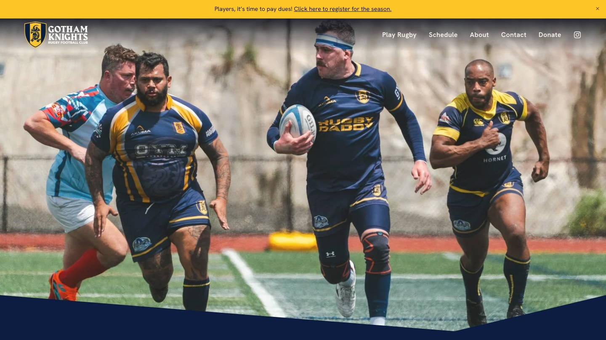
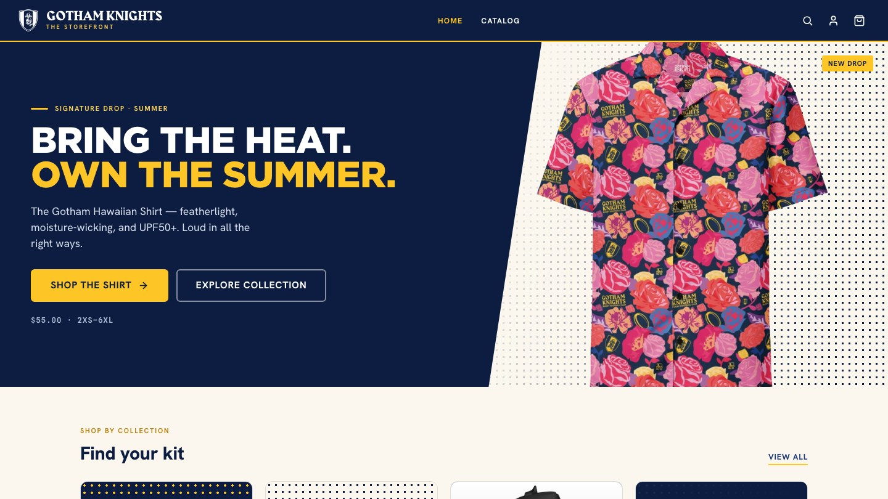

Gotham Knights RFC is New York City's LGBT rugby club. It talks to two rooms at once:
the queer community and the players who live for matchday, and the grant officers and
sponsors who fund the club. The brand had a crest, two fonts, and a tone brief, but no
system behind them. Every poster, deck, and web page was being rebuilt from scratch.

This project turned the assets into a design system, published it as the club's brand
guidelines, and then carried it onto the two places the public actually meets the club:
the website and the merch store.

## One system, two registers

The core idea is that the system ships in two registers that share a single palette and
type set, and only the emphasis changes.

- **Loud / Matchday.** Navy field, gold shouting, all-caps Gotham Black. Posters, socials,
  recruitment.
- **Professional / Clubhouse.** Warm paper, navy ink, Hanken Grotesk headings. Decks,
  grant applications, sponsor one-pagers, the calmer web pages.

Pride is deliberate, not default. The identity leads with navy and gold confidence, and
the spectrum appears as a single rule or highlighted moment rather than a gradient on
everything.

## The style guide

[style.gotham.rugby](https://style.gotham.rugby) is a static site on GitHub Pages, and
the repository behind it is the design system itself, not a copy of it.

- **Tokens as CSS custom properties** for color, type, spacing, motion, and patterns,
  with `loud` and `drag` themes layered on the base. One stylesheet URL is linkable from
  any club project.
- **Nine React primitives** (Button, Badge, Tag, Card, Crest, Input, Stat, SectionHeading,
  FixtureRow), each with a type definition, a prompt file for AI-assisted use, and a
  specimen card, compiled to a single bundle.
- **Brand pattern utilities** for the club's textures: checkerboard, sideline stripes,
  halftone fades, a crest watermark, and a pinstripe for professional documents.
- **Print deliverables** generated from the same tokens: a brand book, a Pantone swatch
  card, and a letterhead with a print-ready PDF.
- **A third register for the club's drag show**, with its own guide, show poster,
  motion pieces, and a render harness that produces the video loops.
- The repo doubles as a Claude design system and an agent skill, so new club material
  can be generated on-brand from a prompt.

## The website

[gotham.rugby](https://gotham.rugby) runs on Squarespace, which the club's volunteers can
edit without a developer. The system was applied within those constraints: Hanken
Grotesk for headings and navigation, the navy and gold palette, the angled navy band
over full-bleed matchday photography, and the gold announcement bar that drives dues and
registration.

## The storefront

[shop.gotham.rugby](https://shop.gotham.rugby) is a custom Shopify theme, open-sourced
under MIT. It started from Shopify's Skeleton theme and was rebuilt section by section
into the club's storefront.

- The design system lives in one Liquid stylesheet of tokens and shared components, so
  the store matches the guide instead of approximating it.
- Custom sections for the hero, collection tiles, featured products, community feed,
  email signup, cart drawer, product page, search, header, and footer.
- Product page accordions for materials, fit, and care are driven from product
  metafields, so the club edits them in Shopify rather than in code.
- Cart mutations are serialized through a queue to stop double-submits from corrupting
  the cart, and price contrast was fixed to meet WCAG AA.
- Pull requests run Theme Check, a JSON validator, and Lighthouse CI. Merges to main
  auto-tag a release and deploy through Shopify's GitHub integration.

## What I learned

A design system for a volunteer-run club has to survive without its designer. That shaped
every decision: tokens over bespoke CSS, Shopify metafields over hard-coded copy,
Squarespace over a custom site for the pages non-developers edit most, and a published
guide that explains the why as well as the what. The two-register idea was the
unlock. It let one brand be loud on a poster and credible in a grant application
without anyone choosing between them.
